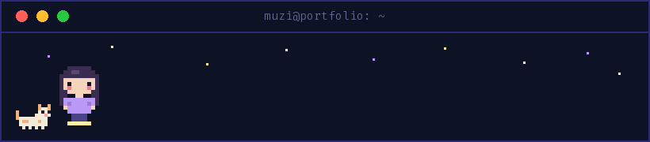

<div align="center">

<a href="https://muzi1i.dev"></a>

# `muzi:$` hi, i'm Muzi 👋

**Data Science @ University of Waterloo** · reinforcement learning · machine learning · retrieval

[](https://muzi1i.dev)
[](https://www.linkedin.com/in/muzi-li01/)
[](mailto:muzi.li1@uwaterloo.ca)

</div>

---

```
λ :: ~ >> whoami
```

I like building things at the intersection of **RL, deep learning and information retrieval** — from
teaching simulated humanoids to play tennis 🎾 to hybrid search engines built from first principles.
When I'm not coding you'll find me on the tennis court, dancing, or baking (yet another) banana bread 🍌

My portfolio is a terminal you can actually type into → **[muzi1i.dev](https://muzi1i.dev)** (try `help`, then `muzi`)

---

### 🛠️ tech i reach for


`reinforcement learning (PPO)` · `U-Net & CNNs` · `RAG / hybrid retrieval` · `LLM evaluation`

---

### ✦ a few things i've built

| | |
|---|---|
| 🔤 **[jax-transformer](https://github.com/zimu1i/jax-transformer)** | a Transformer from scratch in JAX/Flax: hand-written attention & masks, Spanish→English translation |
| 🖼️ **[render-denoiser](https://github.com/zimu1i/render-denoiser)** | a U-Net that denoises Monte Carlo renders (+7.85 dB PSNR, ~6× less compute) |
| ⚖️ **[legal-mind-rag](https://github.com/zimu1i/legal-mind-rag)** | hybrid retrieval over Canadian corporate law, built from first principles |
| 🎾 **[wimbledon-winner-prediction](https://github.com/zimu1i/wimbledon-winner-prediction)** | match-outcome prediction over 120k matches with XGBoost + SHAP |

---

<div align="center">

### 🐱 fun facts

`basically fueled by americanos ☕` · `early bird (brain logs off after 11:30pm)` · `always refining my banana bread recipe`
`i have a 13-year-old cat named Captain` · `lil me wanted to be an astronaut 🚀` · `huge sweet tooth 🍰`

<br>


*⌐ psst — Captain and i live on [muzi1i.dev](https://muzi1i.dev) too. come say hi ✦*

</div>
